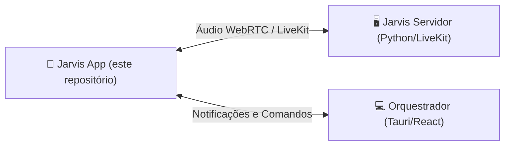

# Jarvis App · Flutter Client & Master Dashboard

Aplicativo multiplataforma (Android, iOS, Windows, macOS, Web) desenvolvido em **Flutter** para interação por voz em tempo real com o ecossistema JARVIS, controle de automações residenciais e monitoramento de limites de IA.

---

## 🌐 O Ecossistema Integrado

O ecossistema JARVIS opera em perfeita sincronia entre os três módulos:



1. **[Jarvis App](.) (este repositório):** Aplicativo móvel e desktop com interface de voz, painel de status mestre e notificações visuais silenciosas.
2. **[Jarvis Servidor](../jarvis-servidor):** Motor de inteligência de voz, orquestração e execução de tarefas.
3. **[Orquestrador](../orquestrador):** Interface para indexação de documentos (RAG), templates de agentes e relatórios técnicos.

---

## ✨ Principais Funcionalidades

- **Assistente de Voz com Baixa Latência:** Conexão direta via WebRTC com o LiveKit para processamento de áudio bidirecional em tempo real.
- **Painel Master (Landscape & Portrait):** Modos otimizados tanto para uso vertical no smartphone quanto para modo paisagem (dock station / tablet).
- **Monitor de Limites de IA (AI Limits):** Exibição em tempo real das cotas restantes de tokens e requisições dos modelos de linguagem, com sistema de cache resiliente a falhas temporárias de rede.
- **Notificações de Canto de Tela (Silent Corner Toasts):** Alertas visuais e não intrusivos no canto da tela informando quando um agente de programação (**Claude Code**, **OpenAI Codex** ou **Antigravity**) concluiu uma tarefa.
- **Consultas Rápidas por Voz:** Pergunte diretamente *"Jarvis, qual o último relatório do Claude?"* para ouvir o resumo sem precisar abrir terminais.
- **Gerenciamento de Alarmes e Lembretes:** Integração nativa com alarmes do dispositivo Android/iOS através de canais de plataforma.

---

## 🛠️ Tecnologias Utilizadas

- **Framework:** Flutter 3.x / Dart 3.x
- **Comunicação em Tempo Real:** [LiveKit Flutter SDK](https://github.com/livekit/client-sdk-flutter) (WebRTC)
- **Gerenciamento de Estado:** Provider / ChangeNotifier
- **Áudio & Visualização:** Visualizador de forma de onda reativo ao fluxo de microfone e voz do agente
- **HTTP & Conectividade:** `http`, `connectivity_plus`, `shared_preferences`

---

## 📂 Estrutura do Repositório

```text
jarvis-app/
├── lib/
│   ├── controllers/            # Controladores de estado (app_ctrl, master_ctrl)
│   ├── screens/                # Telas da aplicação (welcome, agent, master_screen)
│   ├── widgets/                # Componentes visuais (visualizadores de áudio, toasts)
│   ├── services/               # Clientes de API (jarvis_api, alarmes, atualizações)
│   └── models/                 # Modelos de dados (AI Limits, relatórios, status)
├── android/                    # Configurações e bridges nativos do Android
├── ios/                        # Configurações nativas do iOS
├── assets/                     # Ícones, animações e modelos locais
├── test/                       # Testes de unidade e widgets
├── pubspec.yaml                # Dependências e assets do Flutter
└── .env.example                # Modelo de variáveis de ambiente do app
```

---

## 🚀 Como Executar

### 1. Pré-requisitos
- **Flutter SDK** instalado (versão 3.22 ou superior)
- **Android Studio** ou **VS Code** com extensões Flutter e Dart
- Dispositivo físico ou emulador configurado

### 2. Configurar Variáveis de Ambiente
Copie o modelo de ambiente em `assets/`:
```bash
cp assets/.env.example assets/.env
```
Configure os parâmetros no arquivo `assets/.env`:
```env
LIVEKIT_SANDBOX_ID='seu-sandbox-id'
LIVEKIT_AGENT_NAME='my-agent'
JARVIS_API_URL=https://sua-api-jarvis.exemplo.com
```

### 3. Instalar Dependências e Executar
```bash
flutter pub get
flutter test
flutter run
```

Para gerar o APK de release para Android:
```bash
flutter build apk --release
```
